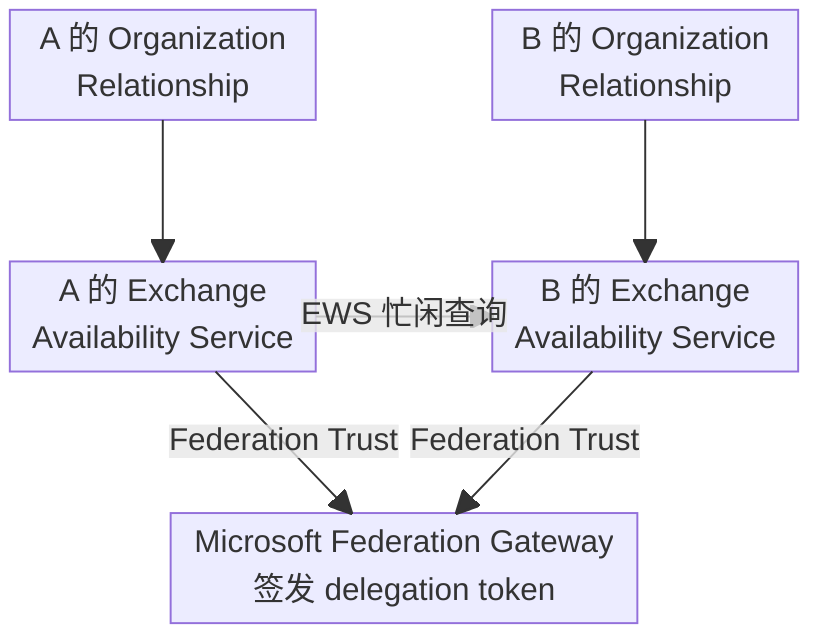
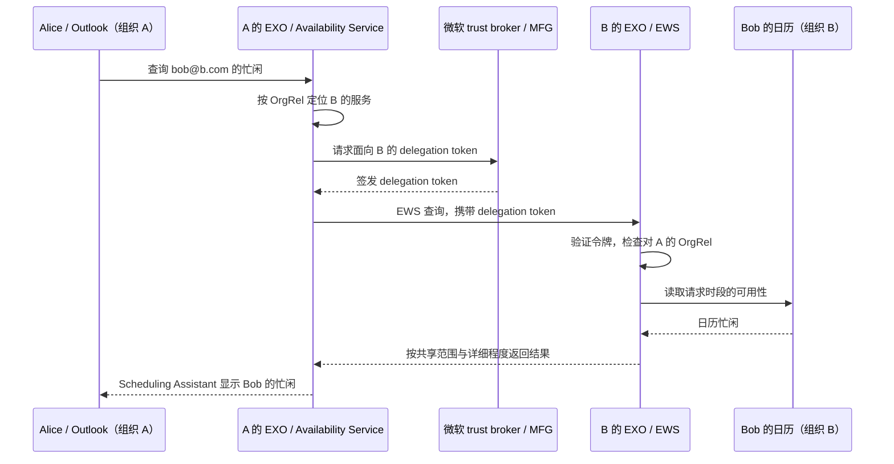
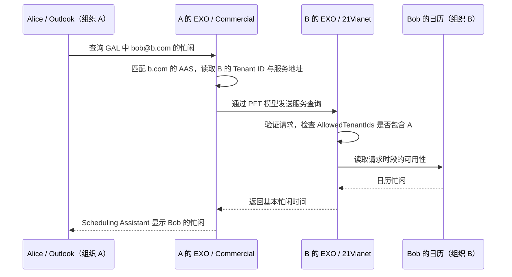

# Exchange Online 如何跨租户共享日历忙闲

Alice 和 Bob 在两家公司工作，经常需要一起开会。Alice 创建会议时，希望直接看到 Bob 明天下午有没有空，而不用每次先发邮件询问。

在 Microsoft 365 中，这件事由 **Exchange Online（EXO，云端邮件与日历服务）** 完成。员工的邮件和日历保存在 EXO 中，Outlook 是员工查看和操作它们的客户端。如果你熟悉 Azure AD（现名 Microsoft Entra ID），可以先这样理解：Entra ID 管理员工的身份与登录，EXO 管理邮箱和日历，并处理谁可以查看哪些日历信息。

本文介绍两条传统的跨租户忙闲共享路径：OrgRel 与 AAS。先看它们适用于哪些部署，再用同一组人物走一遍查询过程。组织 A 的 Alice 使用 `alice@a.com`，组织 B 的 Bob 使用 `bob@b.com`；这两个域名仅用于示例。正文展开 EXO，早期本地 Exchange 的故事作为背景介绍。

## 1. 两条忙闲共享路径：OrgRel 与 AAS

Alice 打开 Outlook 的 **Scheduling Assistant（排程助手）**，添加 Bob 后，界面会显示他在各个时间段的空闲或忙碌状态。这就是 **Free/Busy（忙闲信息）**。例如，Bob 何时有会议，Alice 会看到这一段被占用，再挑选其他时间。

负责回答这个问题的是 Exchange 的 **Availability Service（可用性服务）**。可以把它理解为专门处理“这个人什么时候有空”的服务：它收到目标邮箱和时间范围，读取日历，再返回允许共享的信息。查询另一家公司的员工时，两边的 Exchange 服务需要配合。

管理员先为这种配合建立配置，常见的两条路径是：

- **Organization Relationship（OrgRel，组织关系）**：双方各自在 Exchange 中记录合作组织的信息，并规定本组织哪些人的日历可以向对方共享、共享到什么程度。这条共享路径借助微软签发的令牌验证请求身份。
- **Availability Address Space（AAS，可用性地址空间）**：用于配置向其他 Exchange 组织查询日历忙闲的路径。查询方根据对方员工的邮箱域，找到相应组织的忙闲服务，并按配置的方式发起查询。在 EXO 中，这条路径使用 `OrgWideFBToken`，由目标方通过租户允许列表决定接受哪些组织的忙闲查询。

### 不同部署场景适用哪条路径？

下面的 **on-prem** 指企业自己运行的本地 Exchange Server；**Commercial** 指微软全球商业云；**21Vianet** 指由世纪互联运营的中国云。同一云中的两个租户，也分别拥有自己的用户、邮箱和共享设置。

AAS 的 `AccessMethod` 表示采用哪种查询方式（例如 `PerUserFB`、`OrgWideFB` 和 `OrgWideFBToken`）。这个配置保留了多代 Exchange 的选项，因此矩阵中也列出了早期本地模式。

| 路径：模式            | on-prem–on-prem                                                | Commercial–Commercial                                      | Commercial–21Vianet                              |
| --------------------- | -------------------------------------------------------------- | ---------------------------------------------------------- | ------------------------------------------------ |
| OrgRel：Federation    | 支持；双方建立联合信任，再配置 OrgRel                          | 支持传统忙闲共享，可返回时间、主题和地点；正在迁移到新策略 | 此路径不适用；21Vianet 尚不支持所需的 DAuth 认证 |
| AAS：`PerUserFB`      | 支持；通常依靠本地目录之间的信任，按原始查询用户的权限返回信息 | 不用于两个 EXO 租户之间                                    | 不用于两个 EXO 租户之间                          |
| AAS：`OrgWideFB`      | 支持；目标组织授权一个查询账户，返回目标用户的默认忙闲         | 不用于两个 EXO 租户之间                                    | 不用于两个 EXO 租户之间                          |
| AAS：`OrgWideFBToken` | 不适用                                                         | 支持；服务令牌配合租户允许列表，提供基本忙闲               | 当前官方明确提供的传统忙闲路径；提供基本忙闲     |

> 本地两种 AAS 模式见[跨林 Availability Service](https://learn.microsoft.com/en-us/exchange/architecture/client-access/availability-service-for-cross-forest-topologies)。EXO–EXO 使用 `OrgWideFBToken`；21Vianet 的认证限制及跨云选择见[跨云协作指南](https://learn.microsoft.com/en-us/microsoft-365/enterprise/cross-cloud-collaboration?view=o365-worldwide#enable-freebusy-for-ccb2b-users)。这些名称会在后文结合例子解释。

## 2. OrgRel：先认可请求身份，再决定共享多少

### 2.1 从企业自建邮件服务器说起

在企业普遍自己运行 Exchange 的年代，不同公司各自管理员工账户。A 的服务器认识 Alice，B 的服务器认识 Bob。Alice 想查看 Bob 的忙闲，除了找到 B，还需要解决一个问题：**B 怎样确认，这个请求确实来自 A，并且是在代表 Alice 查询？**

Exchange 2010 加入的 **Federation（联合信任架构）** 给出了一个办法：双方共同信任微软提供的身份服务，由它为跨组织查询签发身份证明，再由各组织自行决定共享权限。OrgRel 就是在这套机制中，记录合作对象与共享规则的配置。[Exchange 2010 时期的共享说明](https://techcommunity.microsoft.com/blog/exchange/exchange-2010-sp1-and-exchange-online-office-365-calendaring-faq/587364/)、[Federation 原理](https://learn.microsoft.com/en-us/exchange/federation-exchange-2013-help)

后来邮箱搬进 Office 365，EXO 承接了这套共享方式。租户在注册后，微软已配好 Federation，两个 Commercial 租户的管理员可以直接配置 OrgRel，选择合作组织与共享范围。[Exchange 团队对云端 Federation 的说明](https://techcommunity.microsoft.com/blog/exchange/managing-federated-sharing-with-the-eac/598111)

### 2.2 OrgRel 这份配置里写什么？

现在回到 Alice 和 Bob。假设两家公司的邮箱都在 Commercial，管理员希望让双方员工互相查询忙闲。

A 在自己的 Exchange 中创建一份关于 B 的 OrgRel，B 也在自己的 Exchange 中创建一份关于 A 的 OrgRel。每份配置都包含合作组织的邮箱域、服务地址，以及**自己愿意向对方开放的信息**。

比如，B 可以规定：A 只能看到 Bob 哪些时间被占用；或者进一步允许看到会议主题和地点。**Alice 查看 Bob 时，B 的共享设置控制返回结果。**

| 配置                    | 用简单的话说                 | 本例                                                           |
| ----------------------- | ---------------------------- | -------------------------------------------------------------- |
| `DomainNames`           | 合作组织使用哪些邮箱域？     | A 填写 `b.com`，B 填写 `a.com`                                 |
| `FreeBusyAccessEnabled` | 是否开放本组织的忙闲？       | `true` 表示开放                                                |
| `FreeBusyAccessLevel`   | 对方能看到多详细？           | `AvailabilityOnly`：只看时间；`LimitedDetails`：增加主题和地点 |
| `FreeBusyAccessScope`   | 本组织哪些人的忙闲可以共享？ | B 可以指定一个包含 Bob 的邮件启用安全组                        |

OrgRel 还保存服务定位信息。**端点**可以理解为服务器接收某类请求的网络地址。**Autodiscover（自动发现服务）** 帮助 Exchange 找到目标服务；**Exchange Web Services（EWS，Exchange Web 服务）** 是 OrgRel 共享路径中接收和处理这些请求的接口。

| 配置                    | 作用                                                   |
| ----------------------- | ------------------------------------------------------ |
| `TargetAutodiscoverEpr` | 保存目标组织的 Autodiscover 地址，用来发现目标服务     |
| `TargetSharingEpr`      | 直接保存目标组织的 EWS 地址，使用这个地址发送查询      |
| `TargetApplicationUri`  | 标识目标组织在委派认证中的身份，申请面向它的令牌时使用 |

管理员可以在 **Exchange Admin Center（EAC，Exchange 管理中心）** 或 Exchange PowerShell 中配置 OrgRel。

### 2.3 微软怎样为查询提供身份证明？

Federation 中负责签发令牌的微软服务，历史上称为 **Microsoft Federation Gateway（MFG，微软联合身份网关）**。它承担 **trust broker（信任代理）** 的角色，意思是：A 和 B 都认可它提供的身份证明。双方与这项服务建立的信任称为 **Federation Trust（联合信任）**。

这里的 **token（令牌）** 可以理解为附在请求上的电子凭证。A 的 Exchange 代表 Alice 申请凭证，B 验证它，再应用自己的共享规则。Federation 使用 **SAML delegation token（SAML 委派令牌）** 。微软跨云指南把 OrgRel 的令牌模型称为 **Delegation Auth Token（DAuth，委派身份验证令牌）**。[Federation 术语与令牌](https://learn.microsoft.com/en-us/exchange/federation-exchange-2013-help)、[DAuth 模型](https://learn.microsoft.com/en-us/microsoft-365/enterprise/cross-cloud-collaboration?view=o365-worldwide#enable-freebusy-for-ccb2b-users)

可以把一次请求理解为：A 带着可信的身份证明来询问，B 先确认来者身份，再按自己制定的规则回答。

图中展示Federation 的逻辑架构。trust broker 提供令牌，日历查询和结果在两端 Exchange 服务之间传递。

### 2.4 Alice 查看 Bob 时，后台发生了什么？

**第一步：Outlook 把问题交给 A。** Alice 添加 `bob@b.com`，选择时间范围。A 的 Availability Service 收到查询。

**第二步：A 找到 B。** A 根据地址里的 `b.com` 找到对应的 OrgRel，再通过其中的服务定位信息确定请求要发往哪里。

**第三步：A 带上身份证明。** A 取得面向 B 的 delegation token，携带它向 B 的 EWS 发送忙闲查询。

**第四步：B 检查自己制定的规则。** B 验证请求，检查对 A 的 OrgRel：忙闲是否开放、Bob 是否在共享范围内、允许返回多少信息。

**第五步：结果回到 Outlook。** B 读取 Bob 的日历，按约定只返回忙闲时间。A 把结果交给 Alice 的 Outlook，于是特定时间显示为忙碌。

如果 B 将等级设为 `LimitedDetails`，结果还可以包含会议主题和地点。OrgRel 也有单独的 **MailTips（邮件提示）** 设置，用来在写邮件时提供自动回复等收件人提示。[OrgRel 功能参数](https://learn.microsoft.com/en-us/powershell/module/exchangepowershell/new-organizationrelationship)

## 3. AAS：给忙闲查询指定路线，再允许合作租户访问

### 3.1 AAS 的起点比 OrgRel 更早

把时间稍微往前拨。在 Exchange 2003 及更早的常见部署中，忙闲信息会发布到 **Public Folders（公共文件夹）** 中，供客户端读取。跨组织使用这些信息时，往往还要安排复制；员工改了会议后，复制的数据也需要更新。

Exchange 2007 的 Availability Service 改进了这件事：服务可以直接读取目标邮箱的日历，按需取得忙闲信息。微软在 2006 年介绍这项功能时，强调的就是减少复制和延迟，让排程助手获得更及时的结果。[Exchange 团队：Exchange 2007 Availability Service](https://techcommunity.microsoft.com/blog/exchange/what-does-exchange-2007-availability-service-do/600923/)

AAS 就来自这一代跨林查询机制。企业可能拥有多个各自管理账户的本地目录环境，称为 **Active Directory forest（AD 林）**。查询另一个林的员工时，Exchange 需要一份配置告诉它：“这个邮箱域属于哪里，应该怎样连接并查询？”AAS 承担的就是这份查询路线表的工作。[早期跨林配置说明](https://techcommunity.microsoft.com/blog/exchange/how-to-configure-the-availability-service-for-cross-forest-topologies/587165)、[跨林 Availability Service](https://learn.microsoft.com/en-us/exchange/architecture/client-access/availability-service-for-cross-forest-topologies)

早期的 `PerUserFB` 通常借助林之间的信任，把原始查询用户的身份交给目标方；`OrgWideFB` 则可使用目标组织授权的查询账户，取得默认忙闲。后来 EXO 提供了 `OrgWideFBToken`，使用云端服务令牌和租户允许列表。AAS 仍然负责指定查询路线，但云端采用了相应的认证方式。[AAS 查询方式](https://learn.microsoft.com/en-us/powershell/module/exchangepowershell/add-availabilityaddressspace)

### 3.2 为什么跨 Commercial 与 21Vianet 会用到它？

现在让 A 的邮箱位于 Commercial，B 的邮箱位于 21Vianet。Alice 与 Bob 的开会需求没有变化，但服务处在两个独立的云环境中。

21Vianet 尚不支持OrgRel 所需的 DAuth。微软为这个忙闲场景提供 AAS 的 `OrgWideFBToken` 路径：A 指定 B 的租户和服务地址，B 明确允许 A 查询。它提供基本时间忙闲。[跨云路径选择](https://learn.microsoft.com/en-us/microsoft-365/enterprise/cross-cloud-collaboration?view=o365-worldwide#when-to-choose-availability-address-space)

### 3.3 两边各自准备哪份配置？

Alice 查询 Bob，需要两边各做一件事：**A 知道去哪里查，B 同意让 A 查。**

A 在自己的 Exchange 中添加 AAS，写入 `b.com`、B 的 **Tenant ID（租户标识符）** 和 B 所在云的服务地址。Tenant ID 就是你在 Entra ID 中见到的那个唯一标识，EXO 用它确定目标租户。

B 则维护 **AvailabilityConfig（可用性配置）**，其中的 `AllowedTenantIds` 是允许来查询忙闲的租户列表。B 将 A 的 Tenant ID 加进去。

| 配置                                  |  在哪里配置| 用简单的话说             | 本例                 |
| ------------------------------------- | ---------- | ------------------------ | -------------------- |
| AAS `ForestName`                      | A          | 哪个邮箱域走这条路线？   | `b.com`              |
| AAS `AccessMethod`                    | A          | 用哪种查询方式？         | `OrgWideFBToken`     |
| AAS `TargetTenantId`                  | A          | 日历在哪个租户？         | B 的 Tenant ID       |
| AAS `TargetServiceEpr`                | A          | 请求发往哪个云服务地址？ | `partner.outlook.cn` |
| `AvailabilityConfig.AllowedTenantIds` | B          | 哪些租户可以来查？       | 加入 A 的 Tenant ID  |

`ForestName` 保留了早期跨林机制的命名，现在按目标员工的邮箱域填写。如果 B 使用多个邮箱域，A 为每个域分别添加 AAS。目标在 Commercial 时，服务地址使用 `outlook.office.com`；目标在 21Vianet 时，使用 `partner.outlook.cn`。[AAS 目标参数](https://learn.microsoft.com/en-us/powershell/module/exchangepowershell/add-availabilityaddressspace)

管理员通过 Exchange PowerShell 创建或更新这些配置。`AllowedTenantIds` 最多包含 25 个租户，可以逐项添加或删除合作租户。如果 Bob 也要查看 Alice，则反向再配置一套：B 指定 A 的查询路线，A 允许 B 查询。[租户允许列表](https://learn.microsoft.com/en-us/powershell/module/exchangepowershell/set-availabilityconfig)

### 3.4 先让 Alice 在通讯录里找到 Bob

在这个跨云 AAS 场景中，Bob 还需要出现在 A 的 **Global Address List（GAL，全局地址列表）** 中。GAL 可以理解为 Outlook 使用的公司通讯录，里面的记录告诉 Exchange 某个人的姓名和邮件地址。

A 的管理员可以创建一个 **Mail Contact（邮件联系人）**，记录 Bob 的名字和 `bob@b.com`；也可以让已有的 **Guest（来宾用户）** 在 GAL 中显示。这样 Alice 就能在排程助手中选择 Bob，A 也能根据记录中的远端邮箱地址找到 `b.com` 的 AAS。[跨云 AAS 的 GAL 要求](https://learn.microsoft.com/en-us/microsoft-365/enterprise/cross-cloud-collaboration?view=o365-worldwide#option-2-enable-calendar-availability-sharing-via-aas)

### 3.5 AAS 怎样证明请求来自获准的租户？

EXO 的 `OrgWideFBToken` 采用 **Protected Forwarded Token（PFT，受保护的转发令牌）** 模型。EXO 服务使用令牌承载请求，B 验证请求，并检查来源租户 A 是否在允许列表里。许可通过后，B 才返回 Bob 的基本忙闲。

微软将这条路径描述为在具有较高应用权限的服务上下文中运行，也就是由 EXO 服务承担查询工作。公开资料未完整披露 PFT 的格式和全部内部签发步骤；这里按已公开的配置与认证模型说明。[PFT 模型](https://learn.microsoft.com/en-us/microsoft-365/enterprise/cross-cloud-collaboration?view=o365-worldwide#enable-freebusy-for-ccb2b-users)

A 的 AAS 指定路线，A 的 GAL 提供 Bob 的邮箱地址，B 的 AvailabilityConfig 控制来源租户许可。这三项准备一起支撑跨云忙闲查询。

### 3.6 Alice 查看 Bob 时，后台发生了什么？

**第一步：Alice 选择 Bob。** Alice 在 Scheduling Assistant 中选择通讯录里的 Bob，Outlook 将他的邮箱地址和查询时段交给 A。

**第二步：A 查路线表。** A 根据 `b.com` 匹配 AAS，知道要查询 B 的租户，并使用 `partner.outlook.cn` 的服务。

**第三步：A 带上服务令牌。** A 的 EXO 按 PFT 模型向 B 发起忙闲查询。

**第四步：B 检查允许列表。** B 验证请求，并确认 A 的 Tenant ID 位于 `AllowedTenantIds` 中。

**第五步：返回忙闲时间。** B 读取 Bob 的日历，把明天下午哪些时间被占用的结果返回 A，再显示在 Alice 的 Outlook 中。

> 两个 EXO 租户之间的 AAS `OrgWideFBToken` 查询路径独立于 EWS，可以继续提供基本忙闲，不受 EWS 退役影响。[EXO AAS 与 EWS 的关系](https://learn.microsoft.com/en-us/exchange/sharing/migrate-to-m365-xtap#review-your-availability-address-space-configurations)

## 4. 邮箱搬上云后，共享方式还在继续演进

从早期发布和复制忙闲，到 Exchange 2007 按需查询，再到 Exchange 2010 借助 Federation 进行组织间共享，产品一直在解决同一个实际问题：让员工更方便地找到共同开会的时间。

EXO 继 OrgRel 和 AAS 后，也开始把相关共享配置迁移到 **Microsoft 365 Cross-Tenant Access Policy（Microsoft 365 跨租户访问策略）**。新的方式把管理员熟悉的 Entra 跨租户信任与具体的日历授权结合起来，能够更细地控制哪些外部用户可以查询哪些本组织员工。

EXO 的 OrgRel 忙闲共享使用 EWS，属于当前迁移范围；AAS 的 `OrgWideFBToken` 可继续使用，并在新策略可用后评估迁移。实际部署需确认目标云的 API 版本与租户发布状态。[微软迁移指南](https://learn.microsoft.com/en-us/exchange/sharing/migrate-to-m365-xtap)

下一篇从 Entra 管理员熟悉的身份策略出发，介绍这套新机制：[从 Entra B2B 到新日历忙闲策略](02-cross-tenant-architecture.md)。
