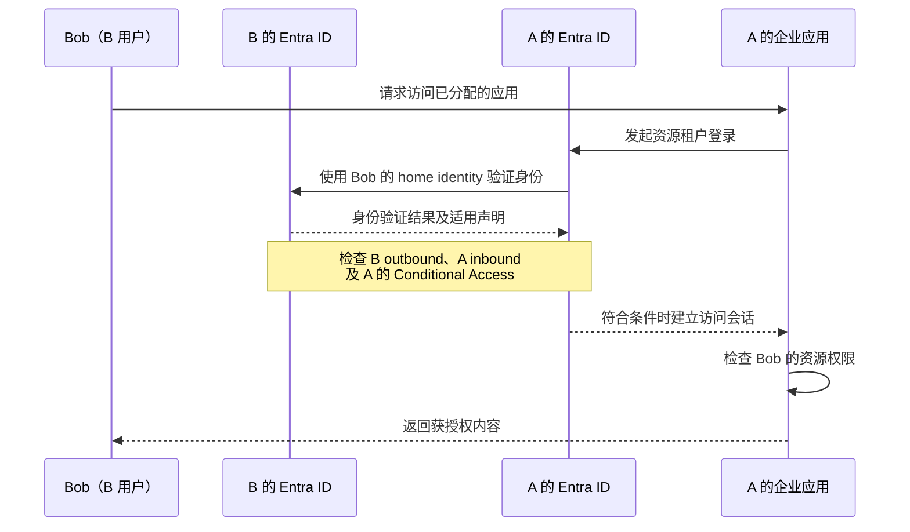
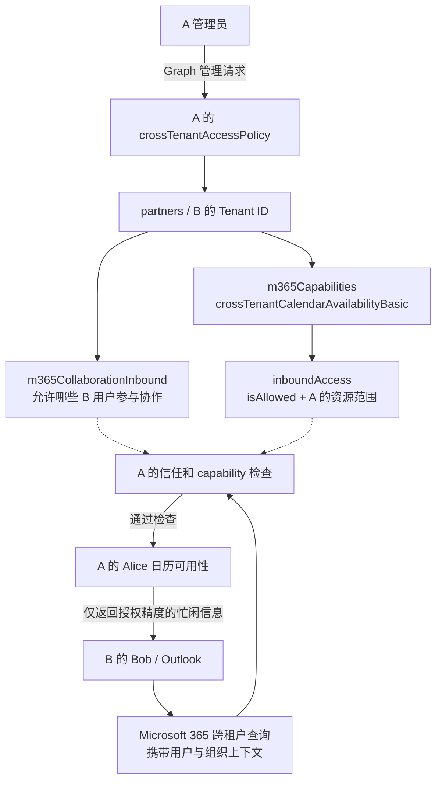
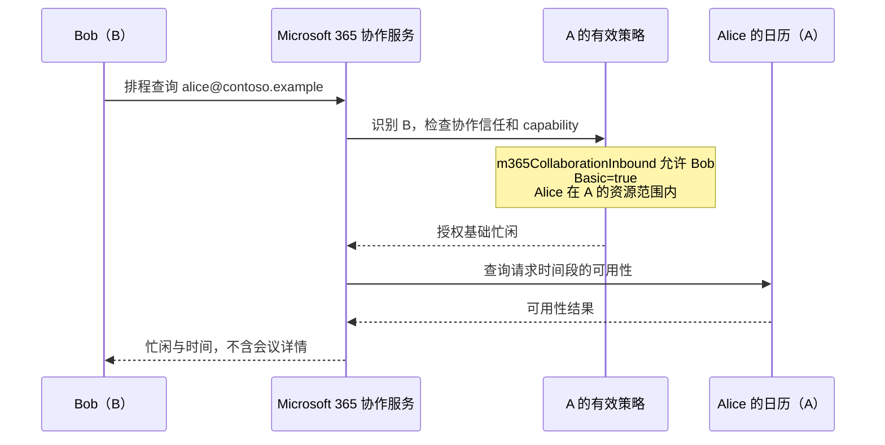

# 从 Entra B2B 到 Microsoft 365 跨租户日历忙闲策略

核查日期：2026-10-13。上一篇：[传统 Exchange 组织共享](01-exchange-federation.md)。下一篇：[21V raw HTTP 配置](03-21v-http-guide.md)。

## 1. 先认识“用户租户”和“资源租户”

假设有两个公司：

| 对象 | A：Contoso 中国 | B：Fabrikam |
| --- | --- | --- |
| 租户 | 21V Microsoft 365 租户 | 主例也是 21V；跨全球云另行说明 |
| 用户 | Alice，`alice@contoso.example` | Bob，`bob@fabrikam.example` |
| 资源 | Alice 在 A 的 Exchange Online 邮箱及日历 | Bob 在 B 的 Exchange Online 邮箱及日历 |

Bob 想查看 Alice 的忙闲时，**B 是 Bob 的 home tenant（用户所属租户），A 是 resource tenant（资源所属租户）**。Alice 查看 Bob 时，两个角色交换。Inbound 和 outbound 总是相对于当前配置所在的租户而言：B 的用户走出去是 B outbound，进入 A 的边界是 A inbound。

这里的“忙闲”是安排会议所需的可用性时间信息。例如“10:00–11:00 忙”，不等于读取完整会议内容。[Entra 跨租户访问概览](https://learn.microsoft.com/en-us/entra/external-id/cross-tenant-access-overview)、[Basic 资源定义](https://learn.microsoft.com/en-us/graph/api/resources/crosstenantcalendaravailabilitybasic?view=graph-rest-beta)。

## 2. 普通 Entra B2B Collaboration 解决什么问题？

### 2.1 一个入门例子：Bob 访问 A 的企业应用

普通 B2B Collaboration 允许 Bob 用自己 B 租户的身份访问 A 中授予他的资源。典型过程如下：

1. A 邀请 Bob，在 A 中建立代表 Bob 的 B2B 用户对象；通常为 Guest。
2. A 为 Bob 分配目标应用或资源权限。邀请成功本身不会授予所有资源访问权。
3. Bob 打开应用并用 B 的账号登录；身份验证使用他的 home tenant。
4. B 的 outbound policy 决定该身份能否访问 A；A 的 inbound policy 决定是否接受 B 的该用户及目标应用。
5. A 仍执行适用的 Conditional Access 和应用授权。如果 A 选择信任 B 的 MFA 声明，Bob 已在 B 完成的 MFA 可以被认可；这不表示 A 取消了 MFA 要求。
6. 全部检查通过，Bob 才能访问已授权的资源。

这是身份登录的逻辑模型，具体应用会有自己的会话与授权实现。[Entra 概览](https://learn.microsoft.com/en-us/entra/external-id/cross-tenant-access-overview)、[B2B Collaboration 概述](https://learn.microsoft.com/en-us/entra/external-id/what-is-b2b)。



### 2.2 三类容易混淆的设置

| 设置 | 控制什么 | 和本次日历配置的关系 |
| --- | --- | --- |
| `b2bCollaborationInbound/Outbound` | 普通 B2B 用户对外部应用的访问边界；可限定用户、组、应用 | 是理解跨租户策略的基础，不能单独替代新日历授权 |
| `b2bDirectConnectInbound/Outbound` | B2B direct connect，例如 Teams Shared Channels | 不应为启用日历忙闲而顺带放开 |
| `inboundTrust` | 是否接受对方已完成 MFA、设备合规、hybrid joined 的声明 | 是 Conditional Access 声明信任，不是忙闲共享开关 |

此外，Tenant Restrictions 管的是员工在本企业网络或设备上使用**其他租户身份**的行为；它与控制本企业账号 outbound 的设置不同。Cross-tenant synchronization 则是同步用户对象的服务，不是忙闲共享必需的同义步骤。[Cross-tenant access settings API 概览](https://learn.microsoft.com/en-us/graph/api/resources/crosstenantaccesspolicy-overview?view=graph-rest-beta)。

### 2.3 Default 与 Partner

每个租户有默认跨租户设置，另外可以为特定组织建立 Partner 配置：

```text
crossTenantAccessPolicy
├── default                         对未明确覆盖的设置提供基线
└── partners/{对方 Tenant ID}        指定合作组织的配置
```

Partner 中明确配置的属性优先；`null` 属性继承默认设置。因此，“创建了 Partner”不能被理解为“此 Partner 的所有访问都已允许”。同云普通 B2B Collaboration 的初始服务默认通常允许 inbound/outbound，B2B direct connect 初始默认阻止；这些是 Entra 服务默认，并非新 Microsoft 365 capabilities 的默认。[API 概览](https://learn.microsoft.com/en-us/graph/api/resources/crosstenantaccesspolicy-overview?view=graph-rest-beta)、[Partner 类型](https://learn.microsoft.com/en-us/graph/api/resources/crosstenantaccesspolicyconfigurationpartner?view=graph-rest-beta)。

## 3. 新的 Microsoft 365 Cross-Tenant Access Policy 增加了什么？

它把特定 Microsoft 365 数据的共享授权放到跨租户策略模型中，替代旧的组织共享配置路径。微软迁移指南说明，传统 OrgRel/Sharing Policy 使用 EWS，迁移涉及 EWS 依赖和高权限访问模式的现代化；AAS 的旧路径应单独判断，不能统称为 EWS 路径。[迁移指南](https://learn.microsoft.com/en-us/exchange/sharing/migrate-to-m365-xtap)。

新模型需要把两层分开理解：

1. **Entra 身份与协作信任层**：识别合作组织和允许参与 Microsoft 365 协作的外部用户。
2. **Microsoft 365 capability 授权层**：决定对方能取得哪类数据，以及本租户哪些用户的资源可被访问。

普通 B2B 的 `b2bCollaborationInbound` 之外，Partner 类型增加了 **`m365CollaborationInbound`**。Calendar Availability 所需的 Microsoft 365 collaboration trust 通过该设置或默认设置建立。没有有效 trust，即使 capability 对象创建成功，运行时也不生效。[Microsoft 365 API 概览](https://learn.microsoft.com/en-us/graph/api/resources/m365-cross-tenant-access-policy-overview?view=graph-rest-beta)。

### 3.1 架构图：管理配置与用户查询是两个过程



这是根据官方公开策略语义绘制的**逻辑架构图**。官方文档未在这里公开全部内部 token exchange、服务端点及调用协议细节；图中的查询节点不代表某个可自行调用的公开 Graph endpoint。管理员的 Graph access token 用来配置策略，不是 Bob 查询 Alice 时使用的管理员令牌。

### 3.2 `m365Capabilities` 是一个多态集合

它属于 Default 或 Partner 的 relationship：

```text
partners/{B Tenant ID}
├── m365CollaborationInbound       身份协作信任
└── m365Capabilities
    └── crossTenantCalendarAvailabilityBasic
        └── inboundAccess
            ├── isAllowed
            └── resourceScopes
                ├── included
                └── excluded
```

集合可包含多种 capability。创建时必须提供 `@odata.type`，指定实际类型；后续更新 URL 用返回对象的 **`name`**，不是另外寻找一个随机 capability GUID。[创建 capability](https://learn.microsoft.com/en-us/graph/api/crosstenantaccesspolicyconfigurationpartner-post-m365capabilities?view=graph-rest-beta)、[更新 capability](https://learn.microsoft.com/en-us/graph/api/crosstenantaccesspolicyconfigurationpartner-update-m365capabilities?view=graph-rest-beta)。

### 3.3 Calendar Availability Basic 的边界

| 功能 | 对外信息 | 用途 |
| --- | --- | --- |
| `crossTenantCalendarAvailabilityBasic` | 基础 free/busy 与时间，不含会议详情 | 会议排程，本文配置目标 |
| `crossTenantCalendarAvailabilityLimitedDetails` | free/busy、时间、主题、地点 | 需要更高可见性时另行批准 |
| Calendar Sharing 系列 | 根据 simple/detail/reviewer 等档位共享日历 | 与忙闲查询分别配置 |

打开 Basic 不等于允许读邮件、修改日历、读取会议正文，也不等于共享完整日历或建立匿名日历 URL。它是外部组织访问特定忙闲信息的策略授权。[Basic 定义](https://learn.microsoft.com/en-us/graph/api/resources/crosstenantcalendaravailabilitybasic?view=graph-rest-beta)、[迁移映射表](https://learn.microsoft.com/en-us/exchange/sharing/migrate-to-m365-xtap#part-2--configure-your-new-microsoft-365-cross-tenant-access-policies)。

## 4. A/B 示例：Bob 怎样拿到 Alice 的忙闲？

### 4.1 管理员预先配置

A 管理员希望只向 B 开放 A 的“项目协作组”成员的基础忙闲：

1. 在 **A** 创建以 **B Tenant ID** 为键的 Partner。
2. 在这个 Partner 设置 `m365CollaborationInbound.users`，允许所选 B 用户参与协作。本文 HTTP 示例使用 `AllUsers`，表示 B 的全部用户；资源范围在下一层收窄。
3. 在这个 Partner 创建 `crossTenantCalendarAvailabilityBasic`，设 `isAllowed: true`。
4. 将 `resourceScopes.included` 设置为 **A 的项目协作组 Object ID**，`excluded` 为空。
5. 若 Alice 是该组成员，她属于可共享资源范围；A 中不在该组的 Charlie 不属于该范围。

这两处范围是不同的：trust 的 `users` 选的是**外部请求者**；capability 的 `resourceScopes` 选的是**本租户资源所有者**。不能把 B 的组 ID 填到 A 的资源范围中。[Inbound setting 定义](https://learn.microsoft.com/en-us/graph/api/resources/crosstenantaccesspolicym365collaborationinboundsetting?view=graph-rest-beta)、[Microsoft 365 范围规则](https://learn.microsoft.com/en-us/graph/api/resources/m365-cross-tenant-access-policy-overview?view=graph-rest-beta)。

### 4.2 用户发起查询

1. Bob 用 B 的身份进入支持此场景的 Outlook 会议排程界面。
2. Bob 输入 Alice 的完整邮箱地址，请求查询某段时间的可用性。
3. Microsoft 365 服务处理跨租户查询；A 识别请求者来自 B，并读取针对 B 的有效策略。
4. A 检查 Microsoft 365 collaboration trust 是否允许该请求者。
5. A 检查 Basic 是否允许，并判断 Alice 是否在 included 范围内、是否被 excluded 排除。
6. 检查通过后，返回基础忙闲。例如 10:00–11:00 显示为忙；Bob 不应看到“董事会预算审议”这样的主题或会议地点。
7. Bob 对 Charlie 的相同查询不应获得这条策略范围外的数据。

上述是解释授权判断的逻辑过程，不保证实际服务内部按相同顺序逐项执行，也不保证客户端对拒绝情况采用某个固定错误文字。



### 4.3 双向共享怎样配置？

| 业务目标 | capability 配置位置 | Partner 的 Tenant ID | resourceScopes 所在租户 |
| --- | --- | --- | --- |
| B 查看 A 的日历 | A | B | A |
| A 查看 B 的日历 | B | A | B |
| A/B 双向查看 | 双方分别配置 | 各自填对方 ID | 各自的本地资源 |

Microsoft 365 capability 是 inbound-only；单向数据共享不要求 B 同时向 A 开放自己的日历。Partner 资源也有 `m365CollaborationOutbound.usersAndGroups`，用于来源租户控制其用户参与对外 Microsoft 365 协作；应检查实际有效设置，不应把它写成“反向日历授权”。官方迁移基线只要求资源租户建立 inbound trust 和 capability，并未要求为了单向共享而创建反向 capability。[Microsoft 365 概览](https://learn.microsoft.com/en-us/graph/api/resources/m365-cross-tenant-access-policy-overview?view=graph-rest-beta)、[Outbound setting 定义](https://learn.microsoft.com/en-us/graph/api/resources/crosstenantaccesspolicym365collaborationoutboundsetting?view=graph-rest-beta)。

### 4.4 是否必须先邀请 Guest？

普通 B2B 应用访问示例有 Guest 对象，不应把该流程机械搬到 Calendar Availability。官方日历迁移步骤是配置 Partner、Microsoft 365 collaboration trust 和 capability，**没有将逐人邀请 Guest 或启用跨租户同步列为该能力的前置条件**。因此本文不添加这些部署步骤，也不声称所有 Microsoft 365 跨租户能力都无需 Guest。

忙闲查询通常可以从已知邮箱地址发起；人员能否自动出现在 GAL、能否通过姓名搜索，是另一项目录/客户端体验。Basic 本身不负责同步通讯录。不要用“找不到姓名”直接判断日历授权失败。[迁移指南](https://learn.microsoft.com/en-us/exchange/sharing/migrate-to-m365-xtap)。

## 5. 范围和默认策略的判断

Microsoft 365 capabilities 系统默认禁用。针对特定 Partner 的 capability 优先于默认 capability；default 是全局基线。本文只配置 Partner，以便限定合作组织。

`resourceScopes` 遵循这些规则：

| included | excluded | 本租户有效资源范围 |
| --- | --- | --- |
| `resourceType: user, resourceId: All` | 空 | 全部用户 |
| A 的项目组 | 空 | 项目组成员 |
| 全部用户 | A 的保密组 | 排除保密组后的用户 |
| A 的项目组 | Alice | 项目组成员中排除 Alice |

**Exclude 优先于 include。** `All` 与 trust 目标中的 `AllUsers` 是不同字段的值，不能互换；`All` 配合 `resourceType` 使用。每次修改后都读回 default 与 Partner，避免只看一段 JSON 就推断全部有效访问。[Microsoft 365 API 概览](https://learn.microsoft.com/en-us/graph/api/resources/m365-cross-tenant-access-policy-overview?view=graph-rest-beta)。

## 6. 21V 部署要单独判断的事项

### 6.1 同云与跨云

先确认 B 所在云：

- **A=21V，B=21V**：本文主例。使用 A 的中国云 Graph 和中国云身份端点进行管理。
- **A=21V，B=全球商业云**：除 Partner 和 capability 外，还需检查双方 Microsoft cloud settings。Entra 官方文档要求跨云双方启用对方云，并以 Tenant ID 添加对方组织。第三篇提供相应 raw HTTP 附加步骤。
- **A=21V，B=美国政府云**：不要套用全球商业云与中国云步骤；Entra 文档列出的跨云 B2B 配对是商业云↔政府云、商业云↔中国云，不能据此推断政府云↔中国云支持。

新 Microsoft 365 API 概览描述同云与跨云支持，但具体云组合、功能 rollout 和用户端行为仍需验证。基础 Entra B2B 跨云支持不等于每个工作负载都已经开放。[跨云 Entra 配置](https://learn.microsoft.com/en-us/entra/external-id/cross-cloud-settings)、[Microsoft 365 概览](https://learn.microsoft.com/en-us/graph/api/resources/m365-cross-tenant-access-policy-overview?view=graph-rest-beta)。

### 6.2 API 支持、版本、界面与 rollout

| 问题 | 核查结论 |
| --- | --- |
| 21V 是否列入 API 支持？ | Partner 和 capability 的相关 beta 操作页明确标为支持 |
| 现在是否能直接在管理中心配置新 capability？ | Microsoft 365 API 概览说 Graph/Graph PowerShell 可配置，Admin Center 支持计划在 GA 后提供；已有 Entra B2B 界面不等于新 capability 界面 |
| 本文为什么用 beta？ | 按本次请求所给资源和版本编写，字段与请求以 beta API reference 为准 |
| v1.0 在 21V 是否可直接替换？ | 本次核查“创建 capability”v1.0 页面将 21V 标为不支持，beta 页面则支持；即使 Basic 的 v1.0 资源说明已存在，也不能据此推断该操作在 21V 可用 |
| 支持矩阵打勾是否表示当前租户已开放？ | 不保证；迁移指南明确提示 rollout 可能尚未到达某个租户 |

Beta API 文档明确提示接口可能变化，生产应用使用不受支持。本文给出基于指定版本的技术分析和配置请求，实施时应确认组织接受的接口版本，并在变更前复核。全球云“不再必须使用 beta”的公告不应覆盖具体操作的中国云支持矩阵；也不要将 v1.0 的资源介绍与 v1.0 操作可用性混为一谈。[beta 创建 capability](https://learn.microsoft.com/en-us/graph/api/crosstenantaccesspolicyconfigurationpartner-post-m365capabilities?view=graph-rest-beta)、[v1.0 创建 capability](https://learn.microsoft.com/en-us/graph/api/crosstenantaccesspolicyconfigurationpartner-post-m365capabilities?view=graph-rest-1.0)、[官方迁移指南](https://learn.microsoft.com/en-us/exchange/sharing/migrate-to-m365-xtap)、[Exchange 团队公告](https://techcommunity.microsoft.com/blog/exchange/cross-tenant-freebusy-mailtips-and-calendar-sharing-are-moving-to-cross-tenant-a/4545169)。

### 6.3 旧策略优先，会造成“假阳性”验收

官方迁移指南明确说明现有 Organization Relationships、Availability Address Spaces、Sharing Policies 优先于新 Microsoft 365 策略。若原本 AAS 已工作，创建新 Basic 后 Outlook 仍能看到忙闲，**不能证明新策略生效**。应先备份并协调旧路径的停用/移除，再进行新路径测试；失败时恢复旧路径。

AAS 不依赖 EWS，迁移指南明确说其 EXO 租户间共享不受 EWS 弃用影响。21V 的历史方案尤其可能使用 AAS，不应为了验证新策略直接删除唯一可用路径。[迁移指南测试与回滚部分](https://learn.microsoft.com/en-us/exchange/sharing/migrate-to-m365-xtap#part-3--test-functionality)。
